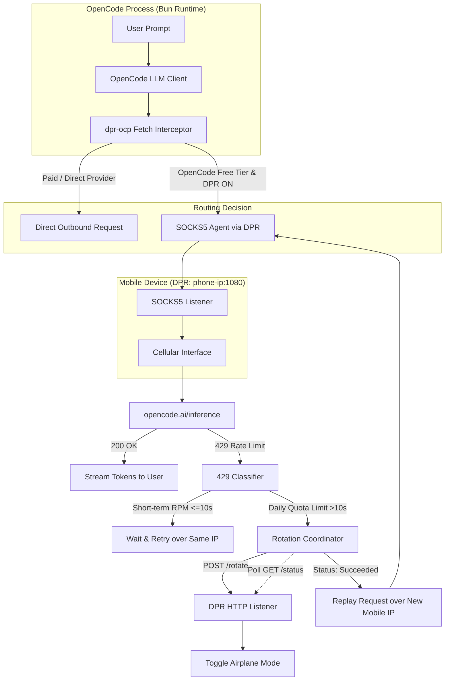

# Implementation Plan: DataProxy-Rotate OpenCode Plugin (`dpr-ocp`)

## 1. Overview & Objective

`dpr-ocp` is an OpenCode plugin that routes OpenCode free-tier model requests (`opencode/*` hitting `opencode.ai/inference/...`) through a mobile device's cellular SOCKS5 proxy via **DataProxy-Rotate (DPR)**. 

When upstream returns an HTTP 429 due to daily free quota limits, the plugin intercepts the failure, requests a mobile IP rotation on the phone (`POST /rotate`), waits for a verified new cellular IP, and transparently replays the prompt request without interrupting the user's session. All other providers (Anthropic, OpenAI, etc.) bypass DPR and connect directly.

---

## 2. Technology Stack & Dependencies

| Component | Choice | Purpose |
| :--- | :--- | :--- |
| **Language** | TypeScript (ES2022+) | Native to OpenCode plugin ecosystem, strict type safety. |
| **Runtime** | Bun / Node.js | Matches OpenCode runtime environment. |
| **Build Tool** | `tsup` | Compiles `src/` to ESM (`dist/index.js`) and generates `.d.ts`. |
| **Plugin API** | `@opencode-ai/plugin` | Hooks, command registration, and tool definitions. |
| **Proxy Client** | `socks-proxy-agent` & `socks` | SOCKS5 client supporting remote cellular DNS (`socks5h://`). |
| **Validation** | `zod` | Runtime schema validation for config and tool parameters. |
| **JSONC Parser** | `comment-json` (or minimal parser) | Reads and preserves comments/formatting in `dpr.jsonc`. |
| **Testing** | `bun test` | Built-in test runner for unit and mock network tests. |

---

## 3. Project Directory Layout

```text
dpr-ocp/
├── docs/
│   ├── spec.md
│   └── plan.md
├── package.json
├── tsconfig.json
├── tsup.config.ts
├── src/
│   ├── index.ts               # Plugin entrypoint (Hooks: config, tool, chat.headers)
│   ├── config.ts              # Loads & persists ~/.config/opencode/dpr.jsonc
│   ├── client/
│   │   ├── dpr.ts             # DPR HTTP client (POST /rotate, GET /status polling)
│   │   └── socks.ts           # SOCKS5 agent builder & reachability tester
│   ├── interceptor/
│   │   ├── fetch.ts           # In-process globalThis.fetch wrapper & stream replay
│   │   ├── classifier.ts      # 429 rate limit classifier (short-term RPM vs. daily quota)
│   │   └── coordinator.ts     # Rotation lifecycle & replay execution
│   ├── commands/
│   │   └── dpr.ts             # Slash commands (/dpr on, /dpr off, /dpr status, /dpr rotate)
│   └── tools/
│       └── dpr.ts             # Model-invokable tools (dpr_status, dpr_rotate, dpr_toggle)
└── test/
    ├── config.test.ts
    ├── dpr-client.test.ts
    ├── classifier.test.ts
    └── interceptor.test.ts
```

---

## 4. Architecture & Component Specifications



### Component Details

#### 1. Configuration & Persistence (`src/config.ts`)
* **Path**: `~/.config/opencode/dpr.jsonc`.
* **Auto-creation**: On first load, writes a documented default template if missing.
* **Inline Overrides**: Accepts inline options in `opencode.json` (`["dpr-ocp", { ... }]`) and environment variables (`DPR_ADDRESS`, `DPR_AUTH`).
* **Runtime Persistence**: Runtime changes (e.g. toggling proxy via `/dpr on` or `/dpr off`) are immediately written to `dpr.jsonc`.
* **Schema**:
  ```typescript
  {
    address: string;          // e.g., "192.168.1.50:1080" (default: "127.0.0.1:1080")
    auth?: {
      username: string;
      password: string;
    };
    enabled: boolean;         // Master toggle (default: true)
    maxAttempts: number;      // Max retry rotations (default: 3)
    pollIntervalMs: number;   // Status poll interval (default: 500ms)
    pollTimeoutMs: number;    // Status poll timeout (default: 15000ms)
  }
  ```

#### 2. DPR HTTP Client (`src/client/dpr.ts`)
* Controls DPR rotation over the shared SOCKS5/HTTP port:
  * `POST /rotate`: Dispatches rotation. Returns HTTP 202 (`accepted`).
  * `GET /status`: Polls state until `"succeeded"`, `"failed"`, or timeout. Supports HTTP Basic auth if enabled.
* Exposes clean async method: `rotate(): Promise<{ success: boolean; ipBefore?: string; ipAfter?: string; error?: string }>`.

#### 3. SOCKS5 Agent & Remote DNS (`src/client/socks.ts`)
* Constructs `SocksProxyAgent` targeting `socks5h://<address>` (remote DNS resolution ensures carrier DNS is used).
* Includes a lightweight health probe to verify DPR reachability before or during operations.

#### 4. Fetch Interceptor & Stream Replay (`src/interceptor/fetch.ts`)
* Intercepts `globalThis.fetch`.
* Filters strictly for requests targeting `opencode.ai/inference/...` (and `opencode.ai/zen/...`). Non-OpenCode requests pass through untouched.
* Buffers the request body (or clones the stream) so that upon an HTTP 429 failure, the identical prompt payload can be replayed.
* Uses custom dispatcher/agent pointing to DPR SOCKS5.

#### 5. 429 Classifier & Notification Engine (`src/interceptor/classifier.ts`)
* Inspects `Retry-After`, `x-ratelimit-reset`, and body text:
  * **Short-term RPM (cooldown <= 10s)**: Awaits the cooldown duration and replays directly over the same IP.
  * **Daily Quota Limit (cooldown > 10s or quota keywords)**: Triggers DPR rotation.
* **Informative Console Notice**:
  * On rotation start: `[DPR] Daily rate limit reached. Rotating mobile IP...`
  * On rotation success: `[DPR] IP rotated (new IP: 188.x.x.x, attempt 1/3). Replaying request...`

#### 6. Failure Policy: Strict Fail-Closed
* If DPR is offline or unreachable: Immediately aborts with `[DPR Error] DataProxy unreachable at <address>. Verify phone Wi-Fi connection and that DataProxy is running.`
* If 3 rotation attempts fail or time out: Aborts request with explicit error.
* Never silently leaks the user's direct IP when DPR routing is enabled.

#### 7. User Controls (`src/commands/` & `src/tools/`)
* **Slash Commands**:
  * `/dpr on`: Enables proxy routing.
  * `/dpr off`: Disables proxy routing (all requests connect directly).
  * `/dpr status`: Prints DPR reachability, toggle state, and active public IP.
  * `/dpr rotate`: Triggers an immediate manual IP rotation.
* **Tools**:
  * `dpr_status`, `dpr_toggle`, `dpr_rotate` callable by assistant.

---

## 5. Implementation Roadmap

- [x] **Phase 1: Project Scaffolding & Configuration**
  - Setup `package.json`, `tsconfig.json`, `tsup.config.ts`.
  - Implement `src/config.ts` with Zod schema, default template generation, and JSONC reader/writer.
  - Add unit tests for configuration loading and overrides.

- [x] **Phase 2: DPR HTTP Client & SOCKS5 Networking**
  - Implement `src/client/dpr.ts` (`POST /rotate`, `GET /status` polling, basic auth).
  - Implement `src/client/socks.ts` (`SocksProxyAgent` creation, reachability probe).
  - Add unit tests with mock HTTP/SOCKS5 server.

- [x] **Phase 3: 429 Classifier & Rotation Coordinator**
  - Implement `src/interceptor/classifier.ts` (parses headers, duration regex, RPM vs. quota distinction).
  - Implement `src/interceptor/coordinator.ts` (orchestrates rotate -> poll -> notify -> replay).
  - Add unit tests covering cooldown edge cases and attempt limits.

- [x] **Phase 4: Fetch Interceptor & Replay Engine**
  - Implement `src/interceptor/fetch.ts` (selective URL matching, body buffering, streaming replay).
  - Implement strict fail-closed error handling and friendly diagnostic messages.

- [x] **Phase 5: OpenCode Plugin Lifecycle & Commands**
  - Implement `src/index.ts` conforming to `@opencode-ai/plugin`'s `Plugin` interface.
  - Register `/dpr` slash commands in `config` hook.
  - Register `dpr_*` tools in `tool` hook.
  - Test end-to-end integration inside OpenCode CLI.
